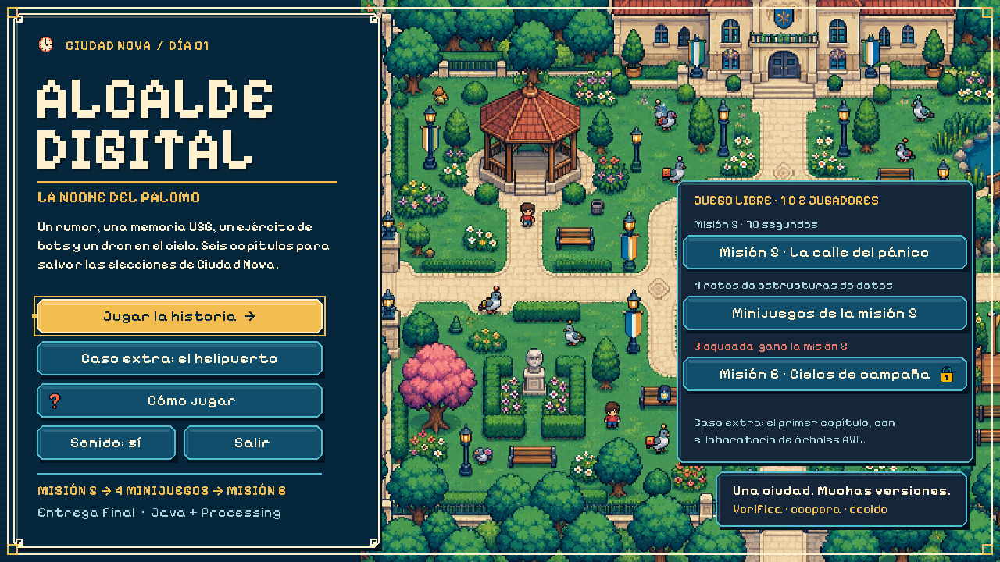
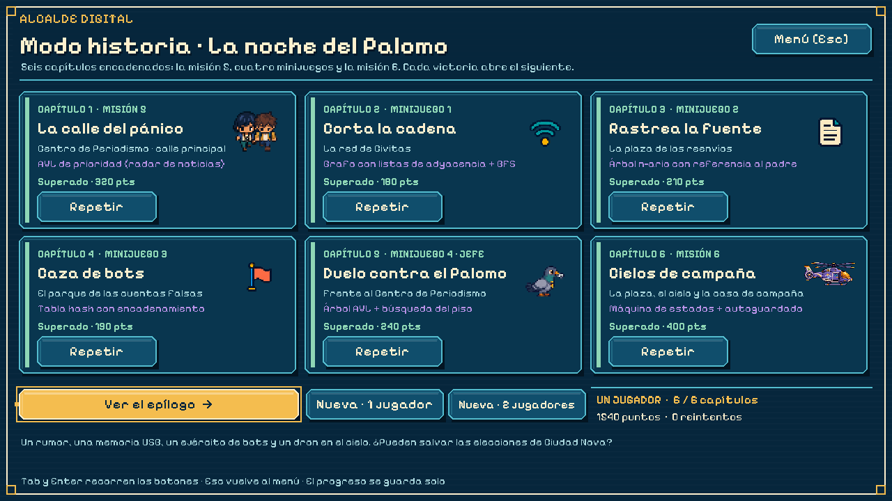
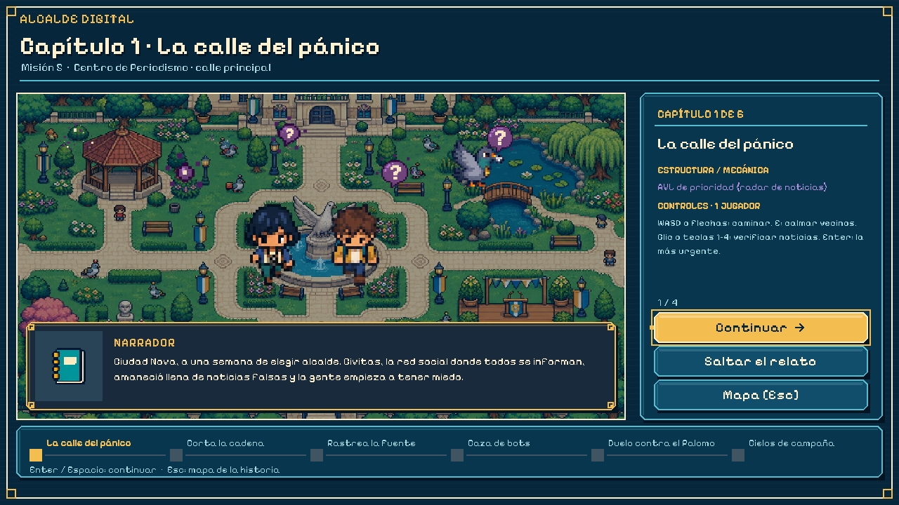
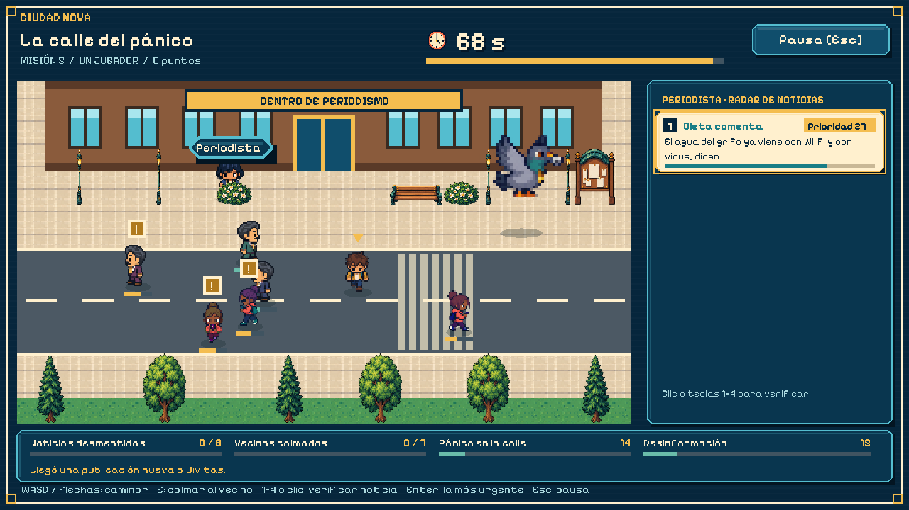
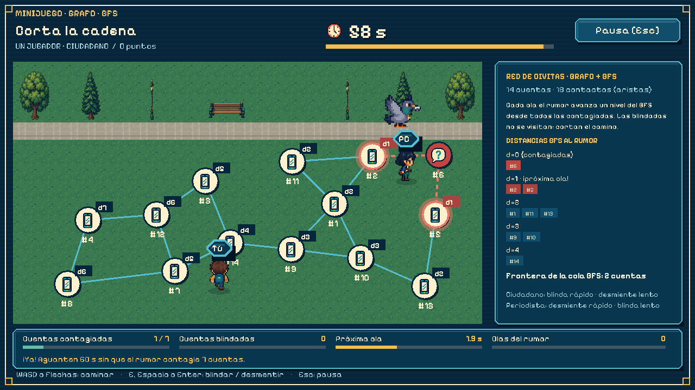
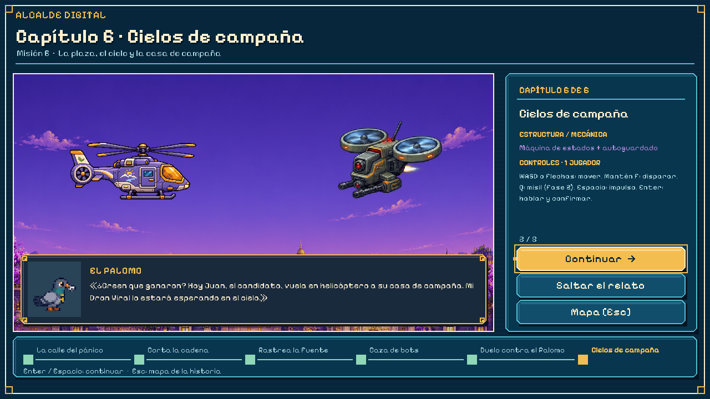
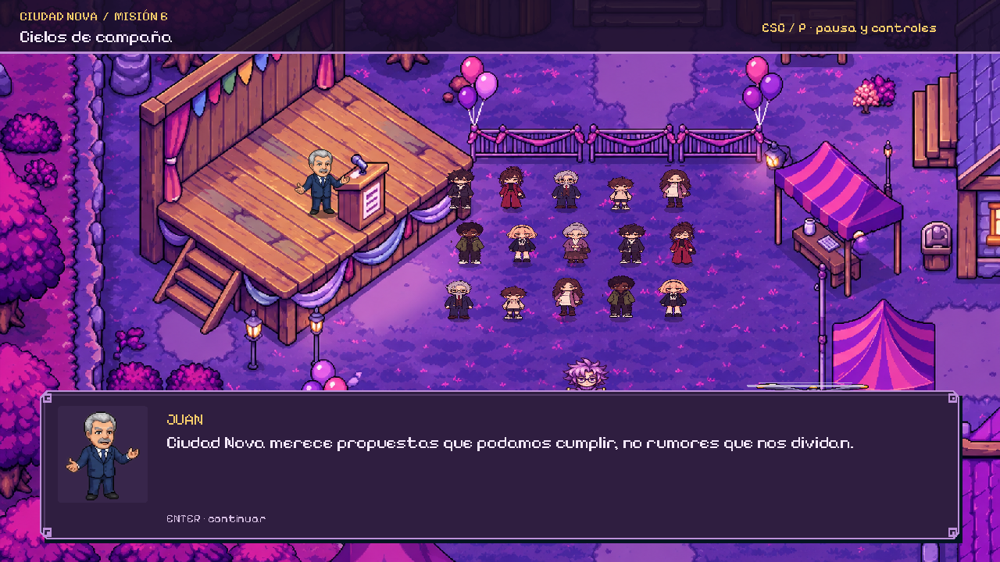
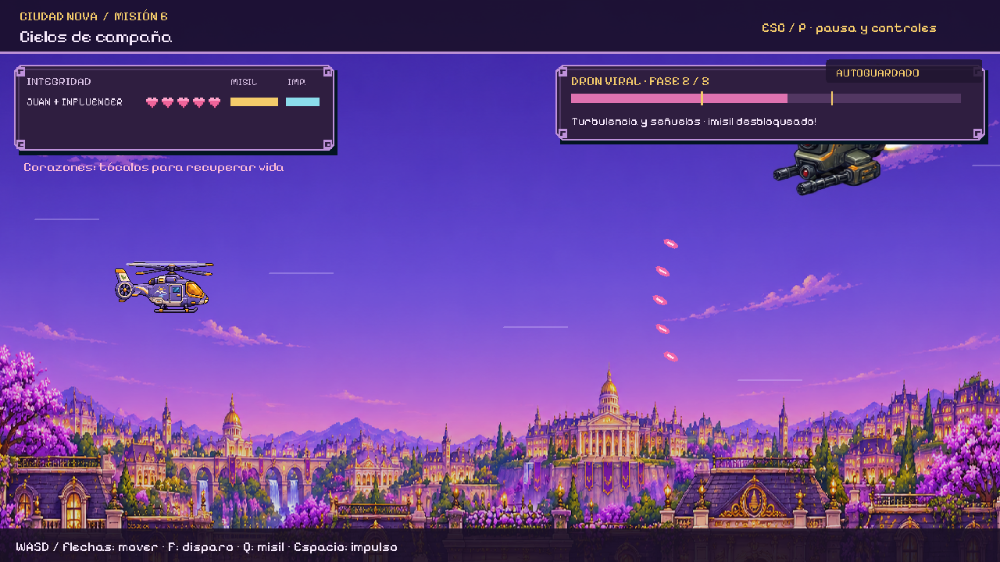
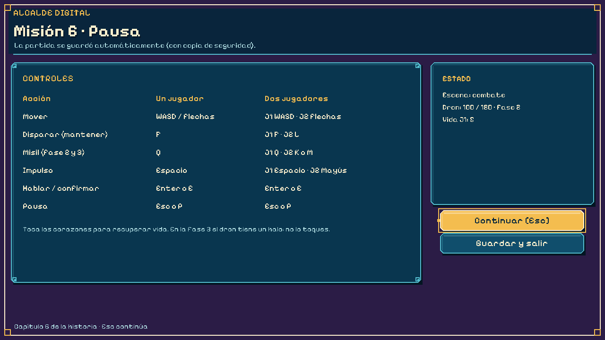
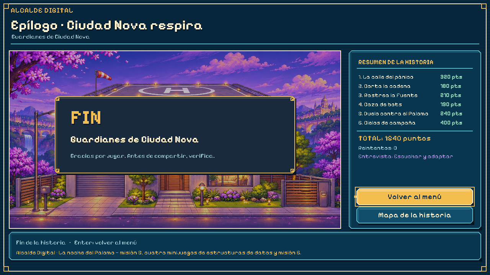

# Alcalde Digital · La noche del Palomo — Guía del juego y de la sustentación

Este documento explica **de qué se trata el juego, qué pasa en cada misión y en cada minijuego, qué estructura de datos usa cada uno y cómo está construido**. Está pensado para presentarlo y responder preguntas en la sustentación.

---

## 1. El juego en una frase

Ciudad Nova está a una semana de elegir alcalde y **el Palomo**, una paloma con lentes oscuros y un celular robado, quiere llenar la red social **Civitas** de rumores para que nadie confíe en nada. Una **Periodista** y un **Ciudadano** lo enfrentan en seis capítulos encadenados, y al final una **Influencer** y **Juan, el candidato**, vuelan en helicóptero contra el dron del Palomo.

- **Género:** aventura 2D de acción y estrategia, pixel art, en español.
- **Jugadores:** 1 o 2 en el mismo teclado (en un jugador, la computadora maneja al compañero).
- **Duración:** unos 15 a 25 minutos la historia completa.
- **Tecnología:** Java 21 + Processing 4.5.6, Maven, JUnit 5 (138 pruebas automáticas).
- **Mensaje:** *antes de compartir, verifica.* Cada mecánica representa una forma real de combatir la desinformación.

## 2. Cómo se juega

1. Abrir el juego con `jugar.bat` (Windows) o `bash jugar.sh` (Linux/Mac). Requiere Java 21 o posterior.
2. En el menú, **«Jugar la historia»** abre el **mapa de la historia**.
3. Elegir **«Nueva historia · 1 jugador»** o **«· 2 jugadores»**. Esa elección vale para toda la historia.
4. Cada capítulo empieza con un **relato** (diálogos con retratos) y luego se juega. **Ganar abre el siguiente capítulo**; si se pierde, se reintenta (la historia cuenta los reintentos).
5. Al terminar la misión 6 aparece el **epílogo**, con el resumen de puntos y un título según los reintentos.

El progreso se guarda solo en `~/.local/state/alcalde-digital/campana.properties`. También existe un **juego libre** (panel derecho del menú) para jugar la misión 5, cualquier minijuego o la misión 6 por separado. La misión 6 suelta se desbloquea al ganar la misión 5.

## 3. La historia completa

| # | Capítulo | Tipo | Qué pasa en la historia | Estructura de datos |
|---|---|---|---|---|
| 1 | **La calle del pánico** | Misión 5 | El Palomo siembra miedo en la calle principal. Al perder, deja caer una **memoria USB**. | AVL de prioridad (radar de noticias) |
| 2 | **Corta la cadena** | Minijuego 1 | El USB tiene la «Operación Pánico Total». Paso 1: un rumor que se reenvía solo por Civitas. | Grafo + BFS |
| 3 | **Rastrea la fuente** | Minijuego 2 | Paso 2: esconder quién inventó el rumor. Hay que subir por la cadena de reenvíos. | Árbol n-ario con padre |
| 4 | **Caza de bots** | Minijuego 3 | Las fuentes eran cuentas falsas con una huella en común. Paso 3: un ejército de bots. | Tabla hash |
| 5 | **Duelo contra el Palomo** | Minijuego 4 (jefe) | Sin bots, el Palomo pelea en persona con un escudo de chismes. Huye y amenaza a Juan. | AVL + búsqueda del piso |
| 6 | **Cielos de campaña** | Misión 6 | La Influencer acompaña a Juan en helicóptero, derriban el Dron Viral y hacen la entrevista. | Máquina de estados + autoguardado |

**Por qué una lleva a la otra:** cada capítulo termina con la pista que abre el siguiente. La USB de la misión 5 contiene el plan de cuatro pasos del Palomo; los cuatro minijuegos son esos cuatro pasos, en orden; al perder el duelo, el Palomo transmite su última amenaza (el dron contra Juan), que es justo el inicio de la misión 6.

### Personajes

- **Periodista:** verifica noticias y desmiente rápido. Es la única que rompe los chismes más fuertes en el duelo.
- **Ciudadano:** calma a los vecinos, blinda cuentas rápido y reporta bots al instante.
- **El Palomo:** el villano. Se burla, inventa chismes, sabotea las lámparas y al final manda un dron.
- **Juan:** candidato a la alcaldía. En la misión 6 da el discurso, vuela y responde la entrevista.
- **Influencer:** recibe el aviso de la Periodista y acompaña a Juan; en dos jugadores maneja el segundo helicóptero.

---

## 4. Capítulo por capítulo

### Capítulo 1 · Misión 5 «La calle del pánico» (70 segundos)

**Historia.** La Periodista sale del Centro de Periodismo tras un ataque informático y se cruza con un Ciudadano asustado. Los dos recibieron la misma invitación sospechosa del Palomo, que aparece para burlarse: «Veamos si pueden salvar la ciudad ahora juntos».

**Cómo se juega.**
- La **Periodista** verifica las noticias que llegan a Civitas: las cuatro más urgentes aparecen ordenadas por prioridad. Verificar toma 1,1 s; si la noticia era verdadera no se desmiente (y se pierde tiempo).
- El **Ciudadano** camina hasta los vecinos asustados y los calma (1,5 s sin alejarse).
- El **Palomo** interrumpe cada pocos segundos con una **burla** (asusta a un vecino), un **chisme** (mete una noticia falsa) o un **sabotaje** (apaga lámparas y crea una zona de pánico).
- **Se gana** al cumplir las dos metas (un jugador: 8 noticias y 7 vecinos; dos jugadores: 11 y 10) sin que el pánico ni la desinformación lleguen a 100. **Se pierde** si alguno llega a 100 o se acaba el tiempo.
- Al ganar, el Palomo huye y deja caer la **memoria USB**: es el gancho del capítulo 2.

**Estructura de datos: árbol AVL.** Cada noticia entra al AVL con clave `(riesgo, ID)`. Se **inserta** al llegar, se **reinserta** con más riesgo cuando una noticia falsa se viraliza (+25), se **elimina** al verificarse y el panel usa el recorrido **inverso** para mostrar primero la más urgente. Como el AVL está balanceado, cada operación cuesta O(log n).

### Capítulo 2 · «Corta la cadena» (60 segundos)

**Historia.** El USB revela el paso 1 del plan: un rumor que se reenvía solo por los contactos de Civitas. Si llega a la mitad de la red, nadie va a creer nada.

**Cómo se juega.** La red se ve como un mapa de cuentas (círculos) unidas por contactos (líneas). Cada **ola** el rumor contagia a todas las cuentas sanas que están a un contacto de una contagiada. Acercándose a una cuenta: si está sana, se **blinda** (corta el camino); si está contagiada, se **desmiente**. El Ciudadano blinda rápido; la Periodista desmiente rápido. El Palomo siembra rumores nuevos cada ~12 s. **Se gana** aguantando los 60 s sin que el rumor llegue a la mitad de la red.

**Estructura de datos: grafo con listas de adyacencia + BFS de varios orígenes.** Todas las cuentas contagiadas entran a la cola con distancia 0; las **blindadas** son nodos bloqueados que el BFS no visita, por eso cortan el recorrido. **Una ola = un nivel del BFS.** En el mapa cada cuenta muestra su distancia `d1`, `d2`… al rumor. Costo: O(V + E).

### Capítulo 3 · «Rastrea la fuente» (85 segundos, 3 rondas)

**Historia.** Paso 2 del plan: esconder quién inventó el rumor. Cada persona en la plaza sabe quién se lo mandó.

**Cómo se juega.** Se pregunta a una persona «¿quién te mandó ese rumor?» y responde **solo un nombre**; hay que encontrar a esa persona en la plaza (los nombres se ven de cerca) y seguir subiendo hasta quien no lo recibió de nadie: una **cuenta falsa del Palomo**. La Periodista además averigua a cuántos reenvíos está de la fuente. El Palomo «silencia» a la persona que buscan y hay que espantarlo.

**Estructura de datos: árbol n-ario con referencia al padre.** Cada nodo guarda a sus hijos (a quién reenvió) y a su **padre** (de quién lo recibió). La pregunta del juego es exactamente `padre(id)`, que cuesta O(1); llegar a la raíz es `caminoARaiz`, O(profundidad). Al terminar cada ronda se dibuja el árbol completo con su altura.

### Capítulo 4 · «Caza de bots» (65 segundos)

**Historia.** Las tres fuentes tenían una huella en común (un ícono y un color). Paso 3 del plan: un ejército de bots que publica cadenas «¡¡COMPARTE YA!!».

**Cómo se juega.** El panel muestra la **tabla de huellas** de bots. El Ciudadano reporta una cuenta al instante, pero si era una persona real sube la desinformación; la Periodista hace un **escaneo de zona** que nunca se equivoca, aunque es más lento. Hay huellas trampa (mismo ícono o mismo color, no ambos). Cada ~14 s el Palomo registra una red nueva. **Se gana** reportando 9 bots (10 en pareja).

**Estructura de datos: tabla hash con encadenamiento separado.** 11 cubetas (número primo). Clave: el texto de la huella, por ejemplo `megáfono·rojo`. Función polinómica `h = (h·31 + carácter) mod 11`. Reportar = `obtener(huella)`: se calcula la cubeta y solo se compara con las claves de esa cubeta. O(1) en promedio. Las colisiones se ven en el panel como listas encadenadas.

### Capítulo 5 · «Duelo contra el Palomo» (90 segundos, jefe)

**Historia.** Sin bots, el Palomo se queda solo y pelea en persona frente al Centro de Periodismo con un **escudo de chismes**. Al perder, huye y transmite su última amenaza: su **Dron Viral** atacará el helicóptero de Juan.

**Cómo se juega.** Se mantiene la acción para cargar un dato verificado (el medidor sube y baja) y se suelta para disparar. Si el dato golpea, rompe **el chisme más fuerte que alcance** (el mayor que sea menor o igual a la fuerza del dato). Con el escudo vacío, cada golpe le quita vida al Palomo (tiene 3). El Ciudadano llega hasta 70 de fuerza; la Periodista hasta 99, por eso es la recomendada en un jugador. Hay que esquivar los chismes que caen (8 corazones de equipo).

**Estructura de datos: el mismo AVL del capítulo 1 + búsqueda del piso.** Cada chisme es una publicación con clave `(fuerza, ID)`. `piso(x)` baja **una sola rama**: si el nodo cabe, lo guarda como candidato y va a la derecha; si no, va a la izquierda. O(log n). Acertar = `piso` + `eliminar`; chisme nuevo = `insertar` con rotaciones (el panel muestra cuál).

### Capítulo 6 · Misión 6 «Cielos de campaña»

**Historia.** La Influencer recibe el aviso de la Periodista y llega a la plaza donde Juan da su discurso. Lo acompaña al helicóptero; en el aire aparece el **Dron Viral**. Tras derribarlo, el Palomo intenta un último rumor («Juan se va a morir») y la Influencer responde que no van a dejar que el miedo decida. Aterrizan en la casa de campaña y hacen la **entrevista**.

**Fases (máquina de estados):** discurso → buscar a Juan → encuentro → caminar al helicóptero → despegue → aviso del dron → **práctica** (moverse y disparar sin riesgo) → **combate** → retirada y transmisión → llegada → explorar la sala → sofá → **entrevista (3 preguntas)** → final. Si se pierde el combate, se reintenta desde la práctica sin repetir la historia.

**Combate.** El dron tiene **180 de energía y 3 fases**: en la 1 dispara ráfagas de 3; en la 2 (bajo 120) hay turbulencia, señuelos y **se desbloquea el misil**; en la 3 (bajo 60) dispara ráfagas de 7 y tiene un halo que daña al tocarlo. Cada helicóptero tiene 5 corazones; aparecen **corazones de curación** cada 6 s. El impulso da invulnerabilidad breve.

**Entrevista.** Tres preguntas con dos respuestas cada una. No hay respuestas «malas»: según la mayoría, el final es **«Escuchar y adaptar»** o **«Convicción y diálogo»**, y el epílogo cambia según la ruta.

**Técnica.** La lógica (`MisionSeisMotor`) es pura y no depende de Processing; el dibujo (`MisionSeisSketch`) escala coordenadas de 1024×576 a la ventana de 1280×720. **Autoguardado** cada 2 s y al pausar, en `mision6.properties`, escrito de forma **atómica** con copia `.bak`: si el archivo se corrompe, se recupera la copia anterior. El sonido (`AudioMisionSeis`) **observa** el motor y nunca lo modifica.

### Epílogo

El dron se autodestruye, la entrevista se transmite completa y en Civitas circula una cadena distinta: «Antes de compartir, verifica». El Palomo sigue suelto… pero la ciudad ya está lista. Se muestra el resumen de los seis capítulos, el puntaje total, la ruta de la entrevista y un título: **Guardianes de Ciudad Nova** (sin reintentos), **Verificadores incansables** (1 a 3) o **Aprendices que nunca se rinden** (más de 3).

---

## 5. Controles

| | Un jugador | Dos jugadores (mismo teclado) |
|---|---|---|
| Menús | Ratón, o Tab + Enter | Igual |
| Moverse | WASD o flechas | J1 WASD · J2 flechas |
| Acción (calmar, blindar, preguntar, reportar, cargar) | E, Espacio o Enter | J1 E/Espacio · J2 Enter |
| Verificar noticia (misión 5) | Clic o teclas 1–4 (Enter: la más urgente) | J2: ↑ ↓ + Enter, teclas 1–4 o clic |
| Disparar (misión 6, mantener) | F | J1 F · J2 L |
| Misil (misión 6, fase 2 y 3) | Q | J1 Q · J2 K o M |
| Impulso (misión 6) | Espacio | J1 Espacio · J2 Mayús |
| Pausa | Esc (misión 6: Esc o P) | Igual |

En un jugador, la computadora maneja al otro personaje en los minijuegos; antes de cada minijuego se elige si se juega como Ciudadano o Periodista (★ = recomendado).

## 6. Qué hicimos al juntar las dos entregas

1. **Un modo historia** (`Campana`) que encadena misión 5 → cuatro minijuegos → misión 6, con relato antes de cada capítulo, mapa de progreso, reintentos y epílogo con dos finales.
2. **La misión 6 dentro del mismo juego**: se dibuja en la misma ventana de Processing, con pausa propia, autoguardado, y en la historia ya no pregunta cuántos juegan (usa lo elegido al empezar).
3. **Guion conectado**: se reescribieron las líneas de la misión 6 que hablaban de otro capítulo para que mencionen el plan del Palomo, la periodista y la transmisión pirata.
4. **Música y efectos en todo el juego**: antes solo la misión 6 tenía sonido. Un director musical elige pista e intensidad según la pantalla: la música se acelera cuando sube el pánico, con el reloj de los minijuegos y en cada fase del dron. Hay efectos de victoria, derrota, verificar, calmar y clics. Se puede silenciar desde el menú.
5. **Menú rediseñado**: botón principal «Jugar la historia», juego libre con la misión 6 bloqueada hasta ganar la 5, ayuda actualizada.
6. **Pruebas nuevas**: historia completa, guardado, música y todas las pantallas nuevas (de 97 a 138 pruebas).

## 7. Cómo está construido

La regla del proyecto se mantiene: **la lógica decide y la interfaz solo dibuja y envía teclas.**

| Paquete / clase | Qué hace |
|---|---|
| `servidor/misiones/Mision5` | Lógica de la misión 5 (sin gráficos). |
| `servidor/minijuegos/*` | Base común `Minijuego` y los cuatro minijuegos. |
| `compartido/estructuras/*` | Estructuras propias: AVL, árbol n-ario, grafo, tabla hash, árbol de decisiones. |
| `cliente/mision6/MisionSeisMotor` | Máquina de estados de la misión 6, combate, entrevista, captura/restauración. |
| `cliente/mision6/MisionSeisSketch`, `AutoguardadoSeis`, `AudioMisionSeis` | Dibujo, guardado atómico y sonido de la misión 6. |
| `cliente/campana/Campana` | **Nuevo.** Capítulos, relatos, progreso, puntajes, reintentos y guardado de la historia. |
| `cliente/audio/DirectorMusical` | **Nuevo.** Elige música y efectos según la pantalla (solo observa). |
| `cliente/audio/MotorAudio`, `MezclaMusical` | Mezclador: una salida estéreo, carga asíncrona y capas «ritmo» y «épica». |
| `cliente/JuegoCliente` | Navegación y entrada: pantallas, teclas, inicio y cierre de cada capítulo. |
| `cliente/interfaz/RenderJuego`, `RenderMinijuegos`, `RenderHistoria` | Dibujo con Java2D (menú, misión 5, minijuegos, historia). |
| `cliente/ClienteSketch` | Ventana Processing de 1280×720: une todo y dibuja la misión 6. |

**Flujo de la historia:** `Menú → Mapa → Relato → Capítulo → Resultado → (victoria) Relato del siguiente … → Misión 6 → Epílogo`. Cuando un capítulo termina, `JuegoCliente` le informa a `Campana` (victoria con puntaje o derrota) y `Campana` guarda el progreso en disco.

## 8. Pruebas

`bash herramientas.sh test` (o `mvn test`) ejecuta **138 pruebas** y todas pasan. Las pruebas usan una carpeta de guardado temporal y no necesitan tarjeta de sonido.

| Grupo | Qué comprueba |
|---|---|
| `CampanaTest` (7) | Orden de capítulos, desbloqueo, mejor puntaje, guardado y recuperación, epílogo según la ruta. |
| `HistoriaTest` (7) | Recorrido real: menú → historia → misión 5 ganada por un jugador automático → minijuego perdido y reintento → minijuego ganado → misión 6 → epílogo; pantallas sin botones encimados. |
| `DirectorMusicalTest` (4) | Cada pantalla tiene música existente, la intensidad sube con el peligro, los efectos solo suenan al cambiar algo. |
| `MisionSeis*Test` (23) | Combate en sus 3 fases en ambos modos, corazones, sala, entrevista, pausa, guardado con copia de seguridad y sonido. |
| `Mision5Test`, `MinijuegosTest`, `EstructurasMinijuegosTest`… (97) | Pruebas originales de la misión 5, los minijuegos y las estructuras. |

## 9. Recursos y créditos

- Arte de la misión 5 y los minijuegos: paquete artístico del proyecto (`src/main/resources/cliente/arte`).
- Arte de la misión 6: ver [`../mision6/ARTE_MISION6.md`](../mision6/ARTE_MISION6.md).
- Música: seis temas generados con vidIQ (libres de regalías según el servicio) y temas MIDI originales renderizados con **GeneralUser GS** de S. Christian Collins (licencia en `src/main/resources/cliente/audio/licencias`). Se convirtieron a mono para que el juego pese la mitad.
- Efectos de helicóptero y combate: sintetizados para el proyecto (`presentacion/audio/ORIGEN_Y_NIVELES.txt`).
- Fuente: Pixelify Sans (licencia OFL incluida).

## 10. Preguntas típicas para la sustentación

- **¿Cómo se conectan las misiones?** Con `Campana`: guarda qué capítulo sigue y solo lo abre si se ganó el anterior. La historia también se conecta en el guion: la USB del final de la misión 5 tiene el plan de cuatro pasos (los cuatro minijuegos), y el duelo termina con la amenaza que inicia la misión 6.
- **¿Por qué la historia no depende de Processing?** Para poder probarla sin ventana. `Campana`, `Mision5`, los minijuegos y `MisionSeisMotor` son lógica pura; las pruebas juegan partidas completas sin pantalla.
- **¿Qué pasa si se cierra el juego a mitad?** La historia se guarda en cada victoria o derrota. La misión 6 se autoguarda cada 2 s; al volver ofrece continuar o empezar de nuevo.
- **¿Cómo es el guardado «atómico»?** Se escribe primero en un archivo temporal y luego se reemplaza el original de un solo paso; antes, la versión válida se copia a `.bak`. Si el archivo principal se corrompe, se lee la copia.
- **¿Qué es la máquina de estados de la misión 6?** Un `enum Fase` con 17 estados; cada tecla o cada tiempo cumplido hace una transición (por ejemplo, energía 0 → RETIRADA; las dos naves sin vida → DERROTA).
- **¿Cómo cambia la música?** `DirectorMusical.elegir` es una función pura: recibe el estado del juego y devuelve pista e intensidad. Las pistas tienen tres capas sincronizadas (base, ritmo, épica); al subir la intensidad entran las capas.
- **¿Por qué BFS y no DFS en «Corta la cadena»?** Porque el rumor avanza por niveles: en cada ola llega a todos los que están a un contacto más. BFS visita exactamente en ese orden.
- **¿Por qué el árbol de «Rastrea la fuente» guarda el padre?** Porque la pregunta del juego es «¿quién te lo mandó?», que es el padre. Con esa referencia, subir cuesta O(1) por paso.
- **¿Qué es el piso en el AVL?** El mayor elemento menor o igual a un valor. Se encuentra bajando una sola rama, O(log n).
- **¿Por qué la tabla hash tiene 11 cubetas?** Un tamaño primo reparte mejor las claves con la función polinómica; las colisiones se resuelven encadenando.
- **¿Cómo juegan dos personas en un teclado?** Cada cuadro se leen las teclas de J1 (WASD + E) y de J2 (flechas + Enter) por separado; en un jugador el otro personaje recibe la entrada de un ayudante automático.

## 11. Guion sugerido para la demostración (5 minutos)

1. **Menú (20 s):** mostrar «Jugar la historia» y el juego libre con la misión 6 bloqueada.
2. **Mapa y relato (40 s):** nueva historia en un jugador; leer el relato del capítulo 1 con Enter.
3. **Misión 5 (70 s):** jugar; señalar el panel ordenado por el AVL y las burlas del Palomo. Al ganar, mostrar la USB.
4. **Un minijuego (60 s):** «Corta la cadena»; explicar las distancias `d1`, `d2` (niveles del BFS) y blindar una cuenta.
5. **Misión 6 (80 s):** desde el mapa abrir el capítulo 6 (o tenerlo avanzado); mostrar el combate, el misil en la fase 2, la pausa con Esc y la entrevista.
6. **Epílogo (30 s):** resumen de puntos, ruta de la entrevista y título final.

Consejo: antes de presentar, conviene tener una historia avanzada hasta el capítulo 6 para no depender de ganar todo en vivo. El mapa permite repetir cualquier capítulo ya superado.
